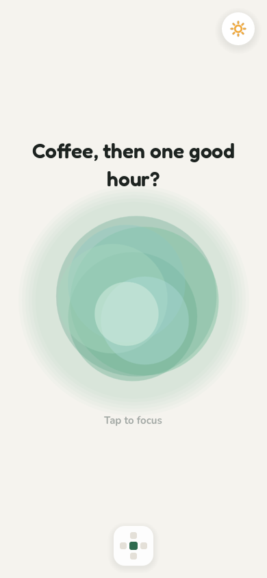
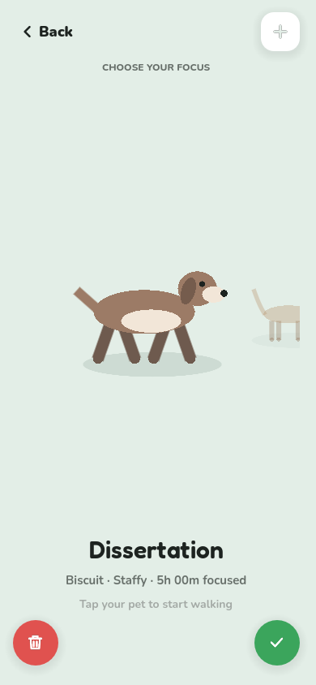
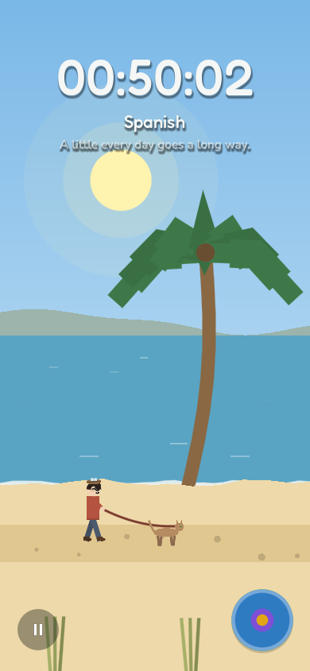
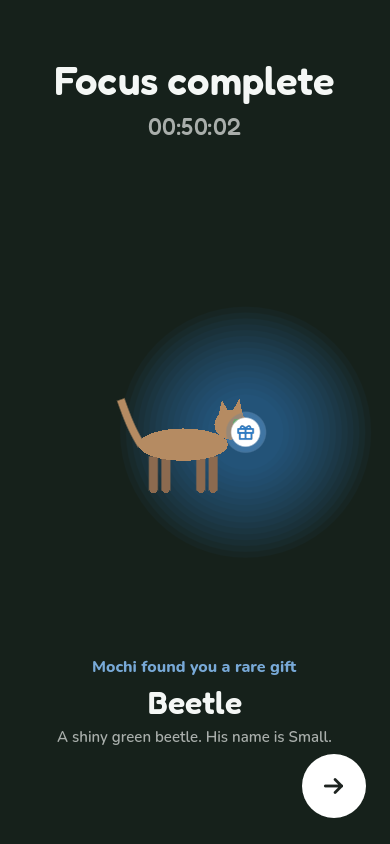
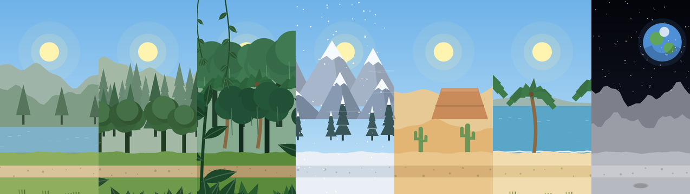
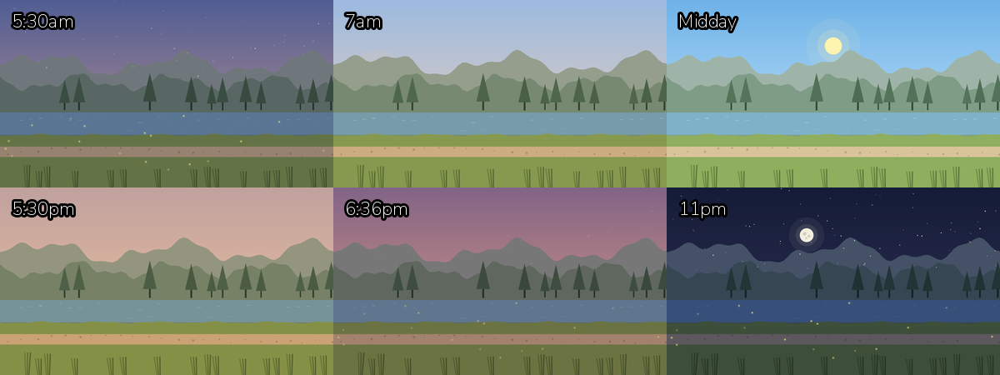
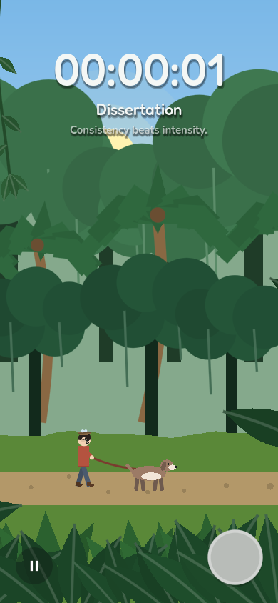
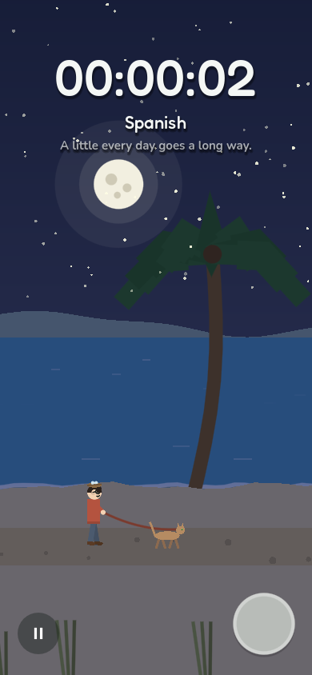
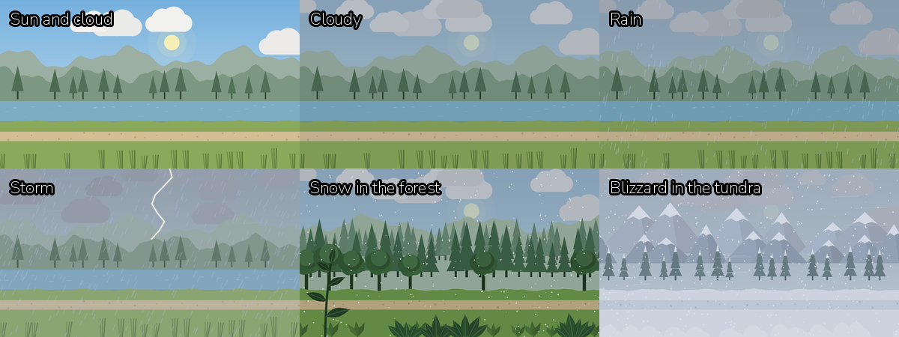
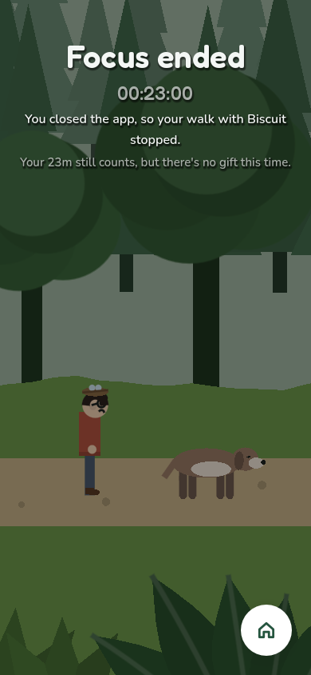

# Paws & Progress

Walk your animals through beautiful scenery while you work. Every project or
course module gets its own animal, every focus session is a walk, and every
walk over 10 minutes ends with a gift.

This is the v2 rebuild in **Godot 4.6** (GDScript), targeting iOS, Android,
macOS, Windows, Linux and Steam from one project. See [ROADMAP.md](ROADMAP.md).

<p>
  
  
  
  
</p>



<p>
  
  
  
</p>

<p>
  
  
</p>

## How it's laid out

The app is five screens arranged like a plus sign. Swipe between them, give
the mouse wheel or trackpad a small flick (a list under the pointer scrolls
first; once it's at its end, a fresh flick moves on), use
the arrow keys on a keyboard (Esc comes back to the middle), click the big
faint arrows at the screen's edges (computers only: one on every side of the
focus screen, and one back home on the others), or use the little map in the
bottom left corner, which shows where you are. It grows up and to the right
into a tile per screen, each with its icon (a home for focus, a present for
gifts, a tick for completed, a person for your profile and a bar chart for
stats). With a mouse it grows while the pointer is over it and shrinks a
moment after it leaves; on phones tap it to grow it, and tap it again (or
anywhere else) to shrink it. Pick a tile to go there.

On computers, Settings also picks the window's mode (windowed, maximised,
fullscreen or exclusive fullscreen) and its size. The window can't get
smaller than 800 × 560 points, so layouts never squash.

```
                 Profile
                    ↑
    Gifts   ←   Focus orb   →   Completed
                    ↓
                  Stats
```

- **Focus** (middle): a greeting (from a long list in `data/text.json`)
  above the orb (it grows under the pointer), and the sun/moon switch for dark
  mode. Tap the orb and the choose focus screen grows out of it, set in the
  place you'll walk (holding still, with the place's growth in front of your
  pets): pick the place from the row at the top (in the order they unlock;
  a highlight slides to the one you pick as the places fade into each
  other), with the project and the pet's name under it. Swipe through your
  pets (each one's kind and time focused is under it) and tap one to set
  off: the screen fades away but your pet, which walks over to the path;
  you walk in from the left to join it, the lead appears with the project's
  name, and a second later you set off together and the clock starts. The
  red-rimmed bin at the bottom rehomes a pet. The × in the top left goes
  back, and the screen shrinks back into the orb. The + in the top right adopts a new one (what it's for, the pet's
  name, its animal and three colours; a locked animal hides the colours):
  while you fill that in the bottom buttons go, the × cancels and the + turns
  into a tick that adopts it. Debug builds (running from the editor) also show
  two small switches beside the home icon in the top left: one unlocks every
  animal and place, the other shows the app exactly as on a phone (an
  iPhone's 390 × 844 screen with its rounded corners, camera island and
  home bar, kept clear of as on the phone; everything is built again at
  that size, with no hovering). The window narrows to fit where it can,
  with black either side where it can't; turning it off puts the window
  back as it was.
- **Gifts** (left): three rings under "Collection stats" for how your
  collection's coming along: gifts discovered (green), pets' gift tables
  completed (blue) and cosmetics unlocked from gifts (purple). Under them,
  every gift you have, eight to a row (five on a phone), each with its count;
  only this list scrolls. Sort by rarity, A–Z or pet type (pick the same one
  again and its arrow flips over to reverse it). Tap a gift for a closer look
  and its trade-in (10 commons for a rare, 5 rares for an epic, 3 epics for a
  legendary); trading away the last of a shelf gift takes it off the shelf.
- **Completed** (right): four headline numbers (projects finished, their
  total focus time, the biggest by focus time and the longest from start to
  finish), then a scrolling list with a panel per finished project. "Sort by"
  orders it by most gifts, biggest, longest, grade, pet type or A–Z; pick the
  same option again to reverse it. Grades sort best first across scales (a
  First, an A* and a 9 share the top band, university first). Tap the circled
  "?" in a panel's corner to give it a GCSE, A-Level or university grade, and
  tap the grade to change it.
- **Profile** (up): one card with your character (the pencil customises it),
  your level badge in the bottom left (it shines under the pointer; tap it
  for every reward) and your XP along the bottom. Beside it, your details at
  the top and your gift shelf of three favourites at the bottom. The shelf's
  pencil opens the shelf editor, with every gift you have (sorted the same
  way as on Gifts). There it's all drag and drop: onto an empty spot to put a
  gift up, onto a full one to swap it in, along the shelf to rearrange, and
  off it to take one down. Gifts on the shelf are greyed out in the
  collection. On a phone, press and hold a gift first, as dragging scrolls
  the list. Under the card, as many achievements as fit: earned ones first
  (hardest won first), then the ones you're closest to. "See all" lists every
  one with how far along it is: 10, 50, 100, 500, 1,000 and 10,000 hours
  focused, every gift found, and a set for each animal's gifts
  (`data/achievements.json`). The page never scrolls. The settings are
  behind the gear in the top right.
- **Stats** (down): this week's focus split by project (the projects scroll
  sideways under the chart), past weeks with any focus in them, your streak
  as a flame with the days beside it (a blue shield on the flame when you've
  earned a rest day: one allowed after three days in a row), and the friends
  leaderboard, which scrolls inside its card. "See full" lists everyone in a
  popup. Tap a friend's face or name for their profile: their character,
  where they study, when they joined, their week, their gift shelf (tap a
  gift for a look) and their achievements. Tap yours for your profile. The
  page never scrolls. Debug builds come with sample friends (`core/friends.gd`).

On a walk, the button in the corner is a pie chart of the gift your pet will
bring back. For the first ten minutes a dark green slice sweeps round; then it
dings and fills with bright green from the middle, and from there blue, purple
and gold slices show the chance of a rare, epic or legendary gift, growing as
you go (rarities below a guaranteed one drop out). The time and the
project's name sit at the top, and under them a line of encouragement types
itself out word by word, changing every ten minutes. The sound button in the top
right mutes everything. Debug builds add a weather picker in the top left and
buttons that add 5, 10, 30 or 60 minutes. When you finish, your pet dives into
a bush and comes back with the gift, turns round to show you, the camera
zooms in, and the XP you earned pours into your level bar at the top. What
it found is along the very bottom.

**Levels.** Every minute focused is 1 XP, plus a bonus for the walk's gift.
Levelling up unlocks new animals and places (lakeside, forest, jungle, tundra,
desert, beach and the moon), all set in `data/levels.json`. Locked ones are
shown greyed out with a padlock and the level they open at. Like the stats,
XP is worked out from the walk log, never kept as a running total.

**Real time.** The places follow the clock. The sky gets lighter until
midday and darker after it; the sun comes up from behind the hills, crosses
the sky and sets, and then the moon does the same overnight. Stars and
fireflies come out at dusk, and the birdsong gives way to the night chorus.
The light at each hour is set in `data/biomes.json` (`day_cycle`) and blended
in between (`core/day_cycle.gd`). In the jungle, big leaves, hanging vines and
tall plants keep passing in front of you and your pet; in the forest, now and
then.

**Weather.** Once you allow it (the app asks once; it's in settings too),
the sunrise and sunset are the real ones where you are (worked out on the
device, `core/sun_times.gd`), and the real weather comes along on your walks,
checked every half hour (`core/outdoors.gd`). Each place shows it its own way
(`data/biomes.json`): sun and cloud, cloud, rain, storms with lightning and
thunder, and snow; in the tundra rain falls as snow and a storm is a blizzard,
it never rains or snows in the desert, the jungle doesn't get snow, and the
moon has no weather at all. Your rough location comes from your internet
connection (get.geojs.io) and the weather from Open-Meteo; nothing else is
sent anywhere.

**Closing the app ends your walk.** Next time you open it, a focus ended screen
shows you and your pet with your heads hung. The time up to when you closed it
still counts, but there's no gift.

**Easter egg.** On the focus complete screen, press and hold the gift to take
it, then flick it. Your pet will fetch it, wading in if it lands in the water.

## Running it

1. Install Godot 4.6 (standard build, not .NET).
2. In the project manager, **Import** and pick this folder's `project.godot`.
3. Press **F5**. Resize the window narrow and tall to see the phone layout.

On first launch on desktop, a save from the original app
(`…/app_userdata/Paws-And-Progress/gamedata.save`) is imported automatically.

## Running it on an iPhone

The iOS export preset is already in `export_presets.cfg`: iPhone only,
portrait, iOS 14 and up, with the paw icon (and a dark mode version) and a
paw launch screen. These steps need your Mac, Apple ID and phone, so they
can't be done for you. Do steps 1 to 4 once.

1. **Xcode.** Install it from the Mac App Store, open it once, and let it
   install the iOS platform. In **Xcode → Settings → Accounts**, add your
   Apple ID. A free account works: the app runs for 7 days, then you run it
   from Xcode again. The paid Developer Program (about £79 a year) removes that
   limit and is needed for TestFlight and the App Store.
2. **Export templates.** In Godot: **Editor → Manage Export Templates →
   Download and Install**. They must match your Godot version exactly.
3. **Your Team ID.** In Godot: **Project → Export → iOS**, and paste it into
   **App Store Team ID**. It's 10 letters and digits:
   - Paid account: [Membership details](https://developer.apple.com/account#MembershipDetailsCard).
   - Free account: in **Keychain Access**, open the "Apple Development: …"
     certificate (Xcode makes it on first run); it's the
     **Organizational Unit**.

   It isn't a secret, so the change to `export_presets.cfg` is fine to commit.
4. **Your phone.** Plug it in, tap **Trust**, then turn on **Settings →
   Privacy & Security → Developer Mode** and let it restart.
5. **Export.** In **Project → Export**, pick **iOS**, then **Export
   Project…**, and keep the path it offers, `build/ios/PawsAndProgress.ipa`
   (`build/` isn't committed). The preset only makes the Xcode project
   there, so Xcode does the signing in the next step.
6. **Run.** Open `build/ios/PawsAndProgress.xcodeproj`, choose your iPhone
   at the top of the window, and press **⌘R**. With a free account, the
   first launch is blocked until you go to **Settings → General → VPN &
   Device Management** and trust your Apple ID.

The bundle ID is `com.joerobson22.pawsandprogress` (**Bundle Identifier**
in the preset). Change it now if you want a different one; it can't change
once the app is on the App Store. If Xcode says it's taken, add something
to the end.

Before the App Store, fill in the privacy details: the weather looks up a
rough location from your IP address (`core/outdoors.gd`), which counts as
"coarse location" data.

## Tests

```sh
godot --headless --path . --import                # once, builds the class cache
godot --headless --path . -s tests/run_tests.gd   # unit tests
godot --headless --path . -s tests/smoke.gd       # drives the whole app with sample data
```

The smoke run draws every place, opens the map and swipes between panes,
arranges the shelf by dragging (on, swapped in, along and off), sorts and
trades gifts, grades a project from its "?", opens every popup (achievements
included), picks a place (and tries a locked one), adopts a pet, walks for
"50 minutes" through to the gift and the XP bar, throws the gift for the pet
to fetch, and switches to dark mode and back.
CI runs all three on every push (`.github/workflows/ci.yml`). With a display,
`-s tests/smoke.gd -- --shots=<dir>` saves a screenshot of each step.

## Layout

```
core/            game logic, no UI
  app.gd           autoload "App": state, saving, walks, trades, navigation
  content.gd       autoload "Content": loads data/*.json
  text.gd          every word on screen, from data/text.json
  outdoors.gd      autoload "Outdoors": location (with permission), weather
  day_cycle.gd     the sky and light at any hour
  sun_times.gd     sunrise and sunset anywhere, worked out on the device
  weather.gd       weather kinds, and how each place shows them
  audio.gd         autoload "Audio": sounds and ambience
  synth.gd         placeholder sounds made in code (bong, pops, rain, thunder)
  game_state.gd    everything that's saved
  save_system.gd   small versioned JSON save with a backup
  session_clock.gd timestamp-based focus timer
  gift_roller.gd   gift odds, guaranteed rarities, pity timer, trade-ins
  levels.gd        XP per walk, and levels from the XP total
  unlocks.gd       what unlocks each animal and place, and how far along you are
  stats.gd         weekly totals, records, streaks (from the focus time per day)
  achievements.gd  achievements and how far along each one is
  friends.gd       the leaderboard order, and sample friends for debug builds
  collection.gd    the gifts screen's rings: discovered, gift tables, cosmetics
  display.gd       the computer window: mode, size, minimum, debug phone view
  models/          ProjectData, FocusSession resources
data/            all content: animals, gifts, drop table, places (biomes),
                 levels, cosmetics, grades, achievements, and text.json
                 (every word on screen, home greetings and walk quotes)
scenes/
  main.gd          the app shell: panes, swiping, minimap, edge arrows,
                   flows, popups
  panes/           focus, gifts, completed, profile, stats (and their base, Pane)
  choose_focus/    choosing and adopting pets
  walk/            the walk, its chunked scenery, focus complete, focus ended
  customise/       the character popup
ui/
  ui.gd            palette, type, theme and builders every screen uses
  motion.gd        every animation: one ease-in-out tween style and timings
  modal.gd         popups, confirmations, prompts, colour picker
  components/      orb, minimap, edge arrow, carousel, gift tile, grid, shelf and
                   details popup, medal card, stat panel, gift button,
                   leaderboard, friend profile, profile card pieces,
                   project panel, character and animal drawings, ...
tests/           headless unit tests and the smoke run
```

## Consistent by construction

- **Words:** screens never write their own text. Every line comes from
  `data/text.json` through `Text` (see below).
- **Look:** screens never style things themselves. Colours, type, buttons,
  cards, tags, badges and portraits all come from `ui/ui.gd`, so a change there
  shows up everywhere. Its palette has a light and a dark set; switching
  rebuilds what's on screen under a fading snapshot of the old colours.
- **Motion:** every animation goes through `ui/motion.gd`, which uses one
  ease-in-out curve and a few shared durations (and halves them, without
  bounces, when "Reduce motion" is on).
- **Popups:** every popup is a `Modal`, so they all open, dim, close and scroll
  the same way.
- **Screens:** each screen's title carries its icon from the app map
  (`Pane.title_row`). Screens are laid out with `Pane.frame()`, which never
  scrolls: content fits the window, and only a panel's own list scrolls
  (`UI.scroll_area`).
- **Pointer:** anything tappable shows a grab hand (`ui/cursor.gd`). There are no tooltips.
- **Sorting:** every sort menu is a `Dropdown` ("Sort by"). Picking the current
  option again flips its arrow, then reverses the order;
  `Dropdown.for_setting` remembers the choice.

## Changing the words (no code needed)

Every word the app shows is in `data/text.json`, grouped by screen
(`"profile"`, `"stats"`, ...), with buttons and words used everywhere under
`"common"`. Change the text on the right and it changes in the app; leave the
names on the left alone.

```json
"delete_title": "Delete {project}?",
"days": { "one": "{n} day", "other": "{n} days" },
```

- Words in `{braces}` are filled in by the app. Keep them, but move them
  wherever reads best.
- A `"one"` / `"other"` pair is the line for one thing and for many.
- Small headings over lists are put in capitals by the app, so write them
  normally.
- **Home greetings:** add a line to `"greetings"`, under the time of day it's
  for (`"morning"`, `"afternoon"`, `"evening"`, `"night"`) or `"anytime"`.
  `{name}` becomes the player's name.
- **Walk quotes:** add a line to `"quotes"`.
- Names and descriptions of animals, gifts, places, clothes, grades and
  achievements stay with the rest of their details in the other `data/` files.

In code, `Text.t("profile.title")` gets a line,
`Text.t("choose_focus.say_hello", {"pet": name})` fills one in,
`Text.count("stats.days", n)` picks one or many, and `Text.list("quotes")`
gets a list. The unit tests check that every key the code uses is in the file.

## Adding content (no code needed)

- **Animal:** add an entry to `data/animals.json` (with its `dive`, `home`
  place, gift `table` and `unlock` rule). A new kind of animal also needs a
  table in `data/gifts.json` with its four gifts (one per rarity; epic and
  legendary need a `slot` and `style`); animals of a kind share one.
- **Unlocks:** each animal and place has an `unlock` rule: a level, hours
  in all, hours in one place, finishing a gift table, or finishing them all.
  The rules are explained at the top of `data/animals.json`.
- **Gift odds and guarantees:** edit `data/drop_table.json`.
- **Trade-in rates:** `trade_in` on each rarity in `data/gifts.json`.
- **Clothes:** `data/cosmetics.json`.
- **Grades:** `data/grades.json`.
- **Achievements:** `data/achievements.json` (hour goals; the gift sets come
  from the animals and gifts).
- **Place:** add it to `data/biomes.json` (name, icon, `unlock` rule,
  ambience) and give it a scenery scene, `art/scenery/<id>/place.tscn`,
  made and changed in the Godot editor. A white `art/places/<id>.png`
  replaces the drawn icon.
- **XP and level thresholds:** `data/levels.json`.

## Art and sound status

[assets/README.md](assets/README.md) is the guide to changing every
picture, place, sound and animation in the Godot editor: each place's
scenery is a scene you open and edit (drawn live in the editor), every
sound's recording, loudness and pitch are in one list
(`assets/sounds/sounds.tres`), and the app's timings and curves in
`ui/motion.tres`. Animals and the character are rigs of separate limbs,
painted red, green and blue and recoloured by a shader. Anything without
art keeps its placeholder:

- Animals: `ui/components/animal_view.gd` draws each animal from its
  recolourable parts. A rig at `animal.sprite_dir`
  (e.g. `res://art/animals/dog1/animal.tscn`) replaces the drawing.
- Character: `ui/components/character_view.gd`, one look per cosmetic `style`; a rig in `art/character/` with per-item pieces in `art/cosmetics/<id>/` replaces it.
- Gifts: `ui/components/gift_art.gd` (every screen showing a gift uses it).
- Scenery: each place's layers are in `art/scenery/<id>/place.tscn`;
  `scenes/walk/scenery_painter.gd` draws a layer's kind (in the editor
  too) and `scenes/walk/scenery.gd` scrolls them in chunks, with
  the sun and moon, the growth in front of the walker, and the weather
  (clouds, rain, lightning, snow, blizzards, the tundra's wind, stars,
  fireflies). The light tints each layer through its node, so the clock
  moving on costs no redrawing.
- Sounds: the bong, pops, rustle, chime, level-up, splash, wind, rain and
  thunder are generated by `core/synth.gd`.
  Drop an `.mp3` with the same name into `assets/sounds/` and it's used instead.

## Key decisions

- **Honest time.** Walk length is always `now - start - paused`, from saved
  timestamps, so backgrounding or sleep can't corrupt it. While you walk, the
  app notes every 30 seconds that it's still open; if it's closed or killed
  mid-walk, the walk ends at the last of those. Walks can run past a day:
  the clock then shows `1d 02:13:05`, and the time is split across the days
  it fell on.
- **Small saves.** The save keeps only what can't be worked out again: your
  profile, projects, focus time per day (by project and by place), XP total,
  gifts and settings. Levels, stats, achievements and unlocks are worked out
  from those and the data files each time, so the data files can change
  freely. A save from another version isn't loaded: the app starts afresh
  and keeps the old file as `.old`.
- **Saves** are written to a temp file and swapped in, with the previous save
  kept as `.bak` and used if the main file is ever damaged.
- **Light on battery.** Panes are built once and only redrawn when something
  changes; the orb stops when it's off screen; walk scenery is drawn once per
  chunk; nothing is drawn at all while the app is minimised or backgrounded.
